# ProtoTwin 3D

Studio de test et de pré-validation de circuits imprimés en 3D interactive, dans le navigateur. On y manipule un PCB réaliste, on appuie sur ses boutons, on tourne son potentiomètre, on pose des sondes de multimètre et d'oscilloscope sur ses broches et on observe sa chauffe avant fabrication.

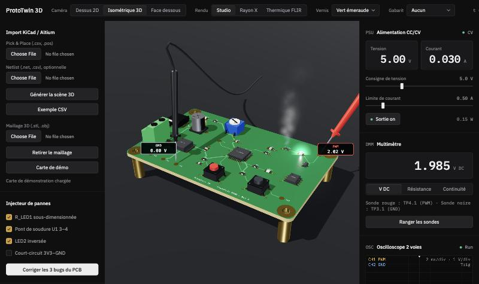

## Lancer l'application

Aucune installation : ouvrez `index.html` dans un navigateur récent. Three.js r128 et les polices IBM Plex sont chargés depuis un CDN, il faut donc une connexion au premier chargement.

```bash
python3 -m http.server 8765
```

Puis ouvrez `http://localhost:8765`.

## La carte de démonstration

Une carte 80 × 50 mm entièrement générée par le code : connecteur USB-C, bornier à vis, régulateur 3,3 V (TO-252), microcontrôleur LQFP-32, ampli-op SOIC-8, MOSFET SOT-23, boutons SW1 et RESET, potentiomètre RV1, trois LEDs, résistances et condensateurs CMS, six points de test.

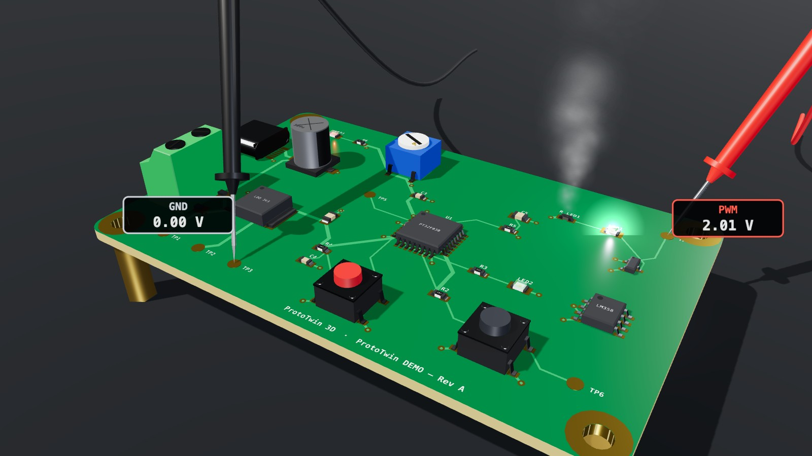

| Geste | Effet |
|---|---|
| Clic sur une patte ou une pastille | Pose la sonde rouge |
| Clic droit, ou Maj + clic | Pose la sonde noire |
| Clic maintenu sur SW1 ou RESET | Enfonce le bouton |
| Molette sur RV1 | Tourne le potentiomètre |
| Glisser | Orbite, panoramique au bouton droit |

## Les 3 bugs intégrés

La carte de démo est livrée avec trois défauts, que le bouton « Corriger les 3 bugs du PCB » diagnostique puis répare.

1. **R_LED1 sous-dimensionnée** : 10 Ω en 0603 dissipe environ 180 mW pour 100 mW admissibles. Elle fume et noircit.
2. **Pont de soudure** entre les broches 3 et 4 du microcontrôleur : l'entrée du bouton reste collée à la masse.
3. **LED2 montée à l'envers** : elle ne s'allume jamais.

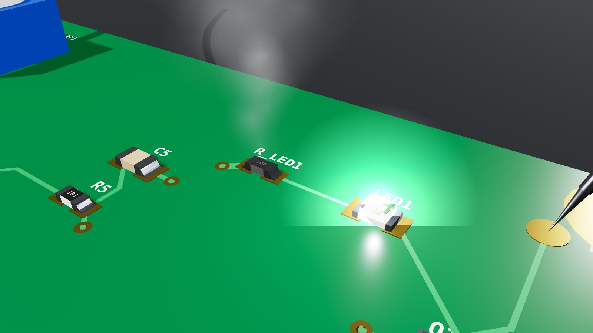
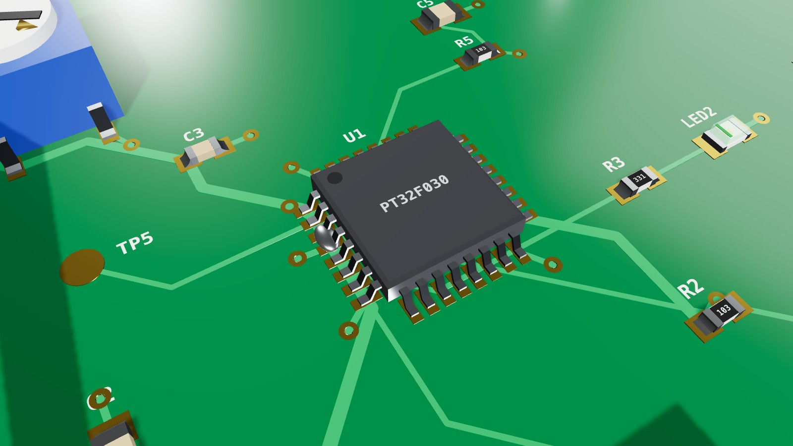
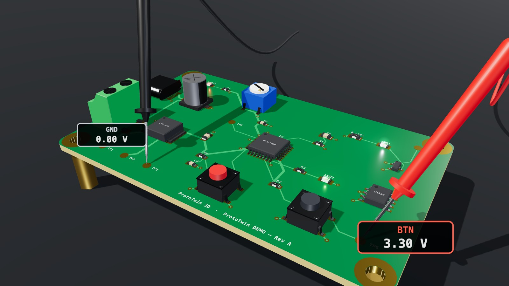

## Modes de visualisation

**Rayon X** : le substrat devient transparent et des sphères circulent le long des pistes selon le courant.

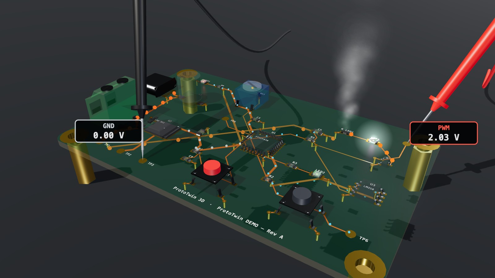

**Thermique FLIR** : chaque composant prend la couleur de sa température, T = Tamb + P × RθJA.

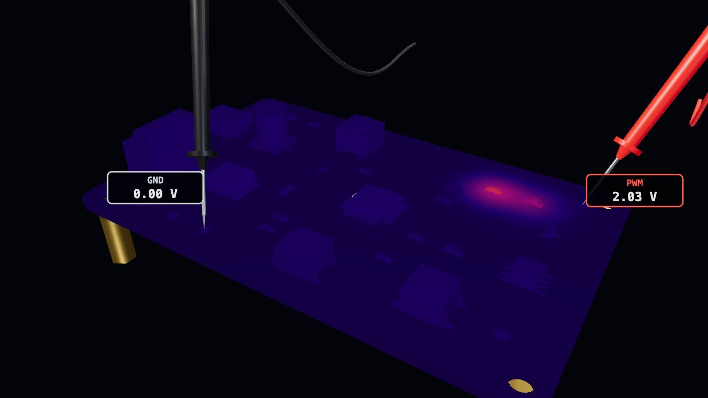

**Vue de dessus et face dessous**

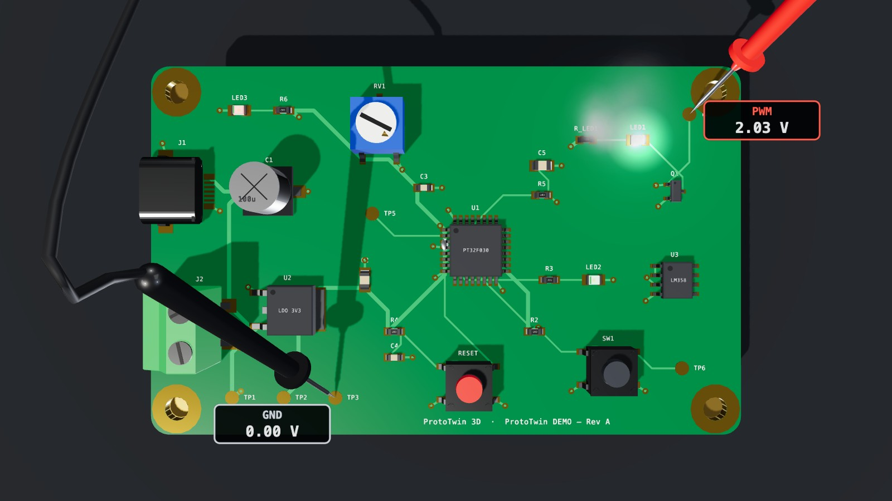
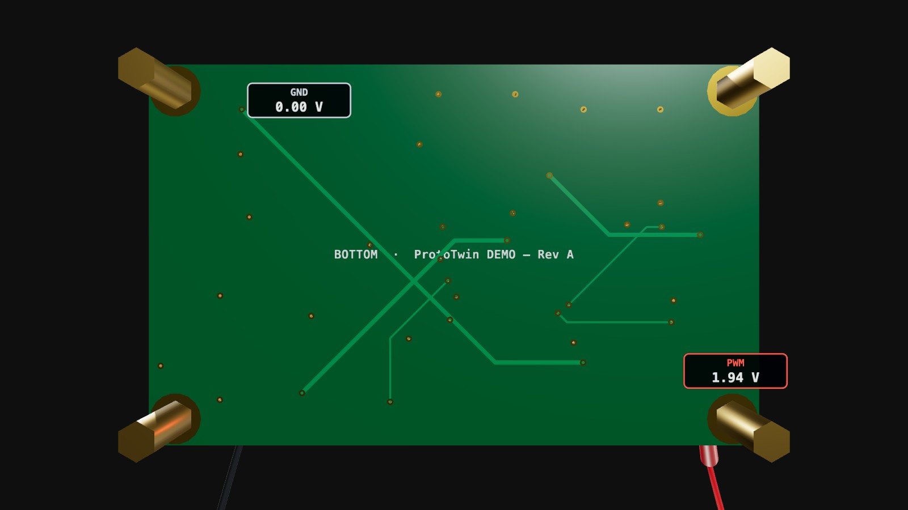

## Gabarits d'ergonomie

Un doigt de 12 mm de diamètre et une prise USB-C complète vérifient qu'aucun composant haut ne gêne l'accès aux boutons et au connecteur.

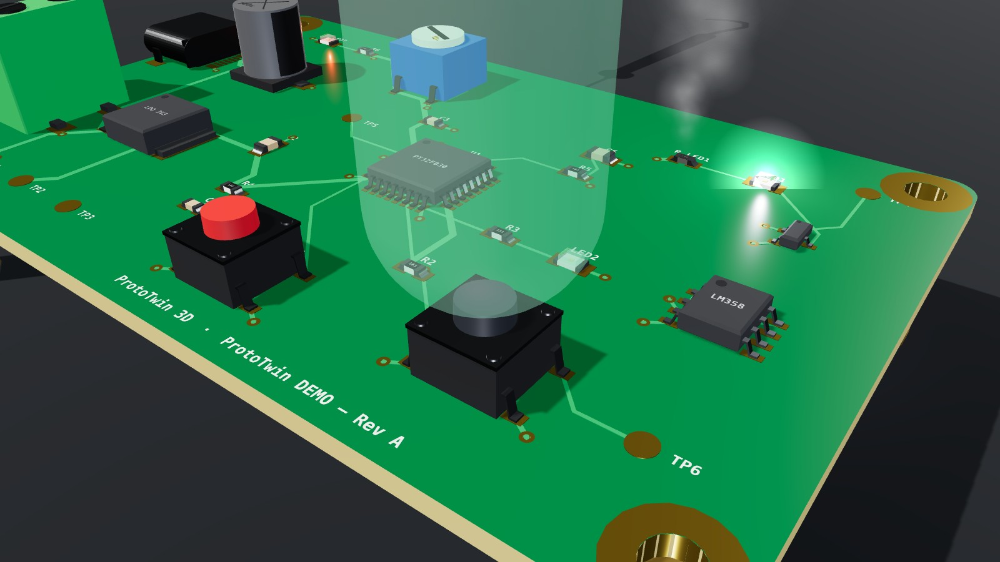
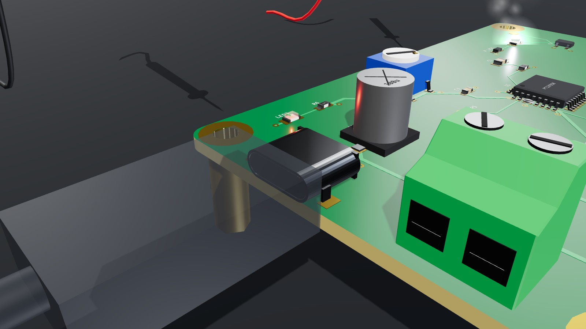

## Instruments

- **Alimentation CC/CV** : 0 à 15 V, limite de courant réglable, bascule en courant constant sur court-circuit.
- **Multimètre** : tension continue, résistance, continuité avec bip.
- **Oscilloscope 2 voies** : CH1 suit la sonde rouge, CH2 la sonde noire, avec déclenchement et capture unique.

PWM du microcontrôleur à 500 Hz :

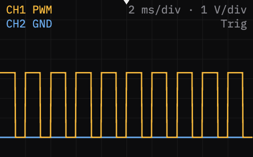

Rebonds mécaniques de 4 ms à l'appui sur SW1 :

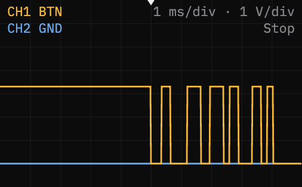

## Firmware du microcontrôleur

Le firmware est du JavaScript exécuté toutes les millisecondes, modifiable dans l'interface.

```js
mcu.pwm('PA2', mcu.adc('PA0') / 4095);   // RV1 règle la luminosité de LED1
mcu.write('PA3', mcu.read('PA1') ? 0 : 1);
```

## Importer sa propre carte

L'importateur lit un fichier Pick & Place (`.csv` ou `.pos`, KiCad ou Altium), une netlist optionnelle (format KiCad ou CSV `Ref,Pin,Net`) et un maillage `.stl` ou `.obj`.

Limites actuelles : pas de lecture directe des `.zip`, `.kicad_pcb` ou `.PcbDoc`, ni de la netlist Protel d'Altium ; le contour de carte est un rectangle déduit des composants ; seuls résistances, condensateurs, LEDs, régulateur et boutons sont simulés sur une carte importée.

## Fichiers

| Fichier | Rôle |
|---|---|
| `index.html` | Interface |
| `styles.css` | Thème |
| `pcb_3d_builder.js` | Moteur 3D Three.js, boîtiers procéduraux, sondes, fumée, raycasting |
| `physics_and_circuit_solver.js` | Carte de démo, import, solveur nodal à 50 µs, thermique, émulateur MCU |
| `app_controller_and_instruments.js` | Boucle temps réel, instruments, audio |

## Crédits

Design de l'interface d'après les principes d'[unslop](https://github.com/heydamir/unslop) de Damir Sokolovsky (CC BY 4.0).
